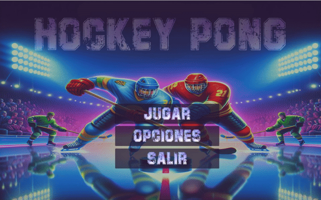
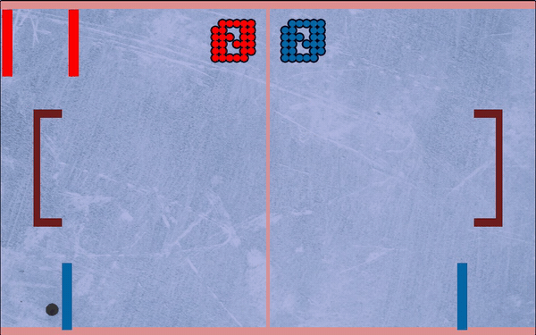

🕹️ HOCKEY PONG - Un clásico con estilo moderno Hockey Pong es un proyecto inspirado en el legendario Pong de Atari, reinventado con una estética más moderna y nuevas mecánicas de juego. Desarrollado en Unity, este juego mantiene la esencia clásica del pong arcade, pero añade mejoras visuales, un delantero, animaciones, sonidos, modos de juego y una IA desafiante para un jugador.

🎮 Demo jugable: https://lesacamedina.itch.io/hockey-pong

🎮 Características destacadas:

✨ Estilo visual renovado con sprites, iluminación y una interfaz más atractiva.

🧠 Modo PvsIA con una inteligencia artificial básica pero efectiva.

👥 Modo multijugador local (PvsP) para jugar entre dos personas.

🔊 Sistema de sonido integrado: música de fondo, efectos de gol, rebotes y más.

⚙️ Opciones de configuración: control del volumen, selección de tipo de pista y modalidad de juego.

🔁 Transiciones suaves entre escenas con persistencia de configuraciones.

💾 Guardado automático de las preferencias del jugador mediante PlayerPrefs.

🚀 Tecnologías utilizadas: 

Unity 6

C#

TMPro (TextMeshPro)

Sistema de audio con AudioManager

Gestión de escenas con SceneManager

🛠️ En desarrollo
Este proyecto sigue en evolución. ¡Se planean más mejoras como power-ups, skins de palas y efectos visuales más dinámicos!
